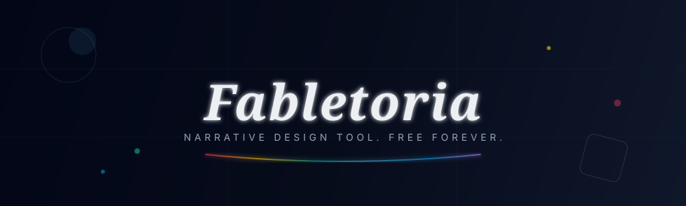
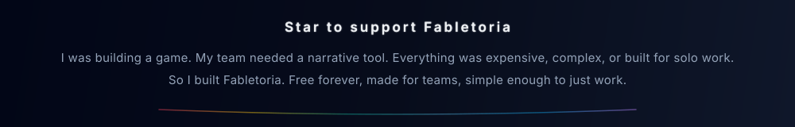

<div align="center">

# Fabletoria

**Your always-free narrative design system**



[](https://github.com/guilhermeljs/fabletoria/actions)
[](https://react.dev)
[](./LICENSE)
[](#)
[](#)
[](#roadmap)

[**Try Fabletoria**](https://fabletoria.com) · [**Report a Bug**](https://github.com/guilhermeljs/fabletoria/issues) · [**Request a Feature**](https://github.com/guilhermeljs/fabletoria/issues)

</div>

---

## What is Fabletoria?

[Fabletoria](https://fabletoria.com) is a **free, open-source narrative design system** built for writers, game designers, and creative hobbyists who want to build and play interactive stories without bloat, paywalls, or complex setups.

You design your narrative visually, then **play it directly** inside the same tool enabling you to *feel your narrative*. 
No account required. No subscription. No hidden limits. Export to any place you want to.

> **Why Fabletoria?** Most narrative tools are either too rigid, too expensive, or built for solo work.
> Fabletoria is free forever, designed for teams to collaborate from day one, and simple enough to
> learn in minutes — yet expressive enough to tell complex, branching stories. We're building this
> in the open, with the community: feedback and feature requests are always welcome through GitHub Issues.

---

## Features

- 🎭 **Narrative Studio** — Visual canvas to design branching stories with nodes and choices
- ▶️ **Built-in Player** — Play your narrative directly inside Fabletoria, no export needed
- 👥 **Real-time Collaboration** — Work with your team simultaneously via WebRTC *(beta)*
- 🤖 **AI Integration via MCP** — Use AI agents to review, narrate, and import narratives from any source into Fabletoria
- 🖥️ **Web & Desktop** — Runs in the browser or as a native Electron app; web version supports PWA with offline mode
- 🔓 **No Account Needed** — Works entirely offline; your stories stay on your machine
- 🆓 **Always Free** — No freemium, no paywalls, no plans. Free forever.

---

## Getting Started

### Web (Recommended for quick use)

Just open [fabletoria.com](https://fabletoria.com) in your browser — no installation required.

### Desktop

Download the latest release for your platform from the [Releases page](https://github.com/guilhermeljs/fabletoria/releases).

> The desktop app is available for **Windows**, **macOS**, and **Linux**.

#### Building from source

**Prerequisites:** [Node.js](https://nodejs.org) v18 or higher

```bash
# Clone the repository
git clone https://github.com/guilhermeljs/fabletoria.git
cd fabletoria

# Install dependencies
npm install

# Start in desktop app development mode
npm run dev

# Start in browser app development mode
npm run dev:browser

# Build the Electron app
npm run build
```
---

## AI Integration (MCP)

The **desktop app** includes a built-in MCP server. To activate it, open Fabletoria and click at the **"MCP"** button in the toolbar.

Once started, any MCP-compatible AI agent can connect to your running Fabletoria instance and work directly with your narrative.

Compatible with: **Claude Code**, **Gemini CLI**, and any SSE MCP-compatible agent.

**What you can do with AI agents:**

- Get a narrative critique: pacing, structure, dead ends
- Generate a whole narrative from a natural language description
- Convert any written story or outline into a Fabletoria project
- Create nodes, narratives, components, EVERYTHING!
- Import from other tools — feed any JSON export to your agent and it converts to Fabletoria

---

## Roadmap

| Feature | Status |
|---|---|
| Narrative Studio | ✅ Done |
| MCP Integration | ✅ Done |
| Web PWA + Offline | ✅ Done |
| Desktop App | ✅ Done |
| Real-time Collaboration (WebRTC) | 🔄 Beta |
| Online Collaboration (cloud relay) | 📋 Planned |

---

## License

AGPL v3 — see [LICENSE](./LICENSE) for details.

---

